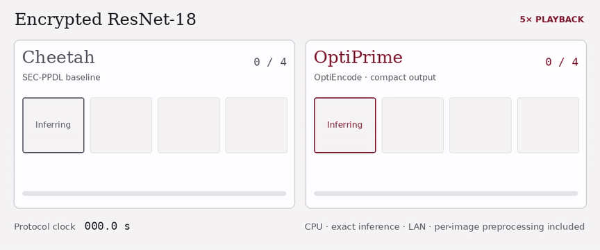

# OptiPrime

**OptiPrime: Optimizing Private Inference through Protocol-Hardware Co-design**

Jiangrui Yu, Ye Yu, Si Chen, Chenqi Lin, Wenxuan Zeng, Junfeng Fan, Mingyu Gao, and Meng Li

MICRO 2026

[Project page](https://jerryfishy.github.io/OptiPrime/) · [Watch the recorded demo](https://jerryfishy.github.io/OptiPrime/#demo) · [Paper](https://arxiv.org/abs/2609.16898)

OptiPrime introduces OptiEncode, a homomorphic convolution protocol that packs output channels to reduce ciphertext communication during private inference. The CPU and GPU implementations are integrated into SEC-PPDL. [Paper](https://arxiv.org/abs/2609.16898) · [Implementation][implementation] · [Experiment guide][experiments]

## Encrypted ResNet-18 in motion

[](https://jerryfishy.github.io/OptiPrime/#demo)

Both sides use the exact W4A8 model on CPU. Each photo appears at its measured completion time, including per-image preprocessing. Playback runs at **5×** on both sides. [Watch with playback controls](https://jerryfishy.github.io/OptiPrime/#demo) · [Timing records](docs/replay.json)

## Results reported in the paper

The MICRO 2026 paper reports end-to-end speedups over Cheetah of up to **5.7× on CPUs** and **4.2× with the HE accelerator**. Across the evaluated networks, OptiEncode uses **11–59% of Cheetah’s communication** and **7–46% of its output ciphertext count**. [Paper, Sections V-B and V-C](https://arxiv.org/html/2609.16898v1#S5.SS2)

The SEC-PPDL implementation also has a separate W4A8 evaluation on CPU and GPU. [Measured latency, communication, and accuracy](results/sec-ppdl.md)

## Run the convolution tests

Check out the SEC-PPDL revision linked below and follow its [dependency setup][dependencies]. From the SEC-PPDL repository root, build and test the CPU operator.

```sh
git clone https://github.com/JerryFishY/SEC-PPDL.git
cd SEC-PPDL
git checkout --detach b986671362e8e6e244ca80a81a0ba6fbccf1c976
# Complete Extern/README.md before configuring the build.
cmake -S . -B build -DCMAKE_BUILD_TYPE=Release -DBUILD_TESTING=ON -DUSE_HE_GPU=OFF
cmake --build build --target test_optiencode_conv -j8
ctest --test-dir build --output-on-failure -R '^optiencode_(algebra|conv)$'
```

- **Use OptiEncode in C++.** Link the `LinearLayer` target and call `Conv2DOptiEncode`. The two-party example shows the server weights, input shares, padding, and output reconstruction. [Public interface][layer] · [Two-party example][example]
- **Run quantized inference.** The experiment guide covers model export, CPU and GPU execution, exact and approximate nonlinear protocols, and verification against the integer reference. [Experiment guide][experiments]
- **Explore post-publication extensions.** MobileNetV2 uses multiplier-one depthwise convolution. The integration includes the BSGS weight preparation and a CPU reproduction of Falcon for comparison. [Depthwise derivation][depthwise] · [Falcon comparison][falcon]

## Citation

If you use OptiEncode, please cite the OptiPrime paper. The full entry is available in [CITATION.cff](CITATION.cff).

```bibtex
@inproceedings{yu2026optiprime,
  title={{OptiPrime}: Optimizing Private Inference through Protocol-Hardware Co-design},
  author={Yu, Jiangrui and Yu, Ye and Chen, Si and Lin, Chenqi and Zeng, Wenxuan and Fan, Junfeng and Gao, Mingyu and Li, Meng},
  booktitle={Proceedings of the 59th IEEE/ACM International Symposium on Microarchitecture (MICRO)},
  year={2026},
  url={https://arxiv.org/abs/2609.16898}
}
```

[implementation]: https://github.com/JerryFishY/SEC-PPDL/tree/b986671362e8e6e244ca80a81a0ba6fbccf1c976
[dependencies]: https://github.com/JerryFishY/SEC-PPDL/blob/b986671362e8e6e244ca80a81a0ba6fbccf1c976/Extern/README.md
[experiments]: https://github.com/JerryFishY/SEC-PPDL/blob/b986671362e8e6e244ca80a81a0ba6fbccf1c976/Experiments/OptiPrime/README.md
[layer]: https://github.com/JerryFishY/SEC-PPDL/blob/b986671362e8e6e244ca80a81a0ba6fbccf1c976/Layer/LinearLayer/include/LinearLayer/ConvOptiEncode.h
[example]: https://github.com/JerryFishY/SEC-PPDL/blob/b986671362e8e6e244ca80a81a0ba6fbccf1c976/Test/src/TestOptiEncodeConv.cpp
[depthwise]: https://github.com/JerryFishY/SEC-PPDL/blob/b986671362e8e6e244ca80a81a0ba6fbccf1c976/Experiments/OptiPrime/depthwise.md
[falcon]: https://github.com/JerryFishY/SEC-PPDL/blob/b986671362e8e6e244ca80a81a0ba6fbccf1c976/Experiments/OptiPrime/falcon/README.md
